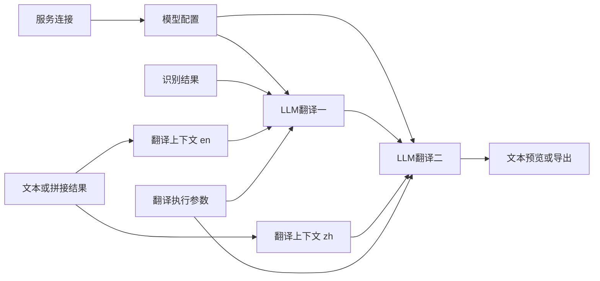

# LLM API 翻译

`llm_translate` 使用兼容 Chat Completions 的 HTTP API，不引入自主 Agent 或工具调用。处理节点仅消费上游当前文本、模型绑定、翻译上下文及可选执行参数。新配置契约见[可组合节点规格](../spec/composable-node-configuration.md)。

## 搭建

1. 添加服务连接，选择 `openai_chat`，填写 API base 和 Key。若接口为 `https://example.com/v1/chat/completions`，地址填 `https://example.com/v1`。
2. 把连接接入模型配置，填写模型名称；请求参数可手填 JSON，也可来自 JSON 值/合并节点。
3. 添加翻译上下文，设置目标语言；源语言为空时继承直接上游的当前语言。两种语言均可搜索候选或填写自定义代码。
4. 翻译要求、背景可以连接文本值或文本拼接结果，术语表可以连接 JSON 值或合并结果，如 `{"先輩":"前辈"}`。构造节点也可直接手填。
5. 识别结果接入 LLM 翻译，模型和上下文接对应端口，输出接文本预览或文本输出。需要调整超时、分批或重试时连接翻译执行参数。

同一模型/连接可以给多个翻译节点使用；每个节点可接自己的上下文。上下文不是随意覆盖请求的消息对象：适配器统一构造核心协议，背景和要求按固定顺序进入提示，术语表按结构提供。

下面的两次翻译共享同一模型/连接，目标语言分别由上下文提供：

## 当前文本

预览、导出和翻译均消费直接上游声明的当前文本：识别后显示原文；首次翻译后显示译文；第二次翻译使用第一份译文及其语言。例如 `ja → en → zh` 的两次翻译可以共享模型，分别接英语与中文上下文。

原文、ID、片段顺序、时间戳、说话人及元数据保留。译文写入新 Transcript 的 `translated_text`，`metadata.current_text` 声明当前字段及语言；没有声明的识别结果按原文处理，非法声明不回退。输出节点重跑可以复用翻译 checkpoint，不新增云请求。

## 组合与参数

文本拼接按左、右端口及分隔符连接，多份文本可以链式组合。JSON 合并为顶层合并，默认重复键报错，也可显式选择左值或右值。组合后仍检查大小和消费端类型，不能通过拼接绕过限制。

翻译要求和背景合成后最多 8192 字符及 32 KiB，词表最多 256 条及 16 KiB。模型请求参数默认空，显式发送的可选参数不能覆盖核心消息、模型、认证、路由、工具或结构协议；同协议的非预设模型可自由配置。

未连接执行参数时，默认每批 20 段、正文及相邻上下文共 6000 字符、前后各最多 2 段上下文、最多 2 次尝试及整次处理 120 秒。相邻片段预算不包含固定提示/词表；不是 token 预算，也不证明模型窗口足够。单段超限在请求前拒绝，不拆分同一片段或补造时间戳。

仅明确限流、服务端错误或无效输出作有限重试；断线或超时不自动重发未确认请求。结果须完整匹配本批 ID，遗漏、重复、错 ID、拒绝和截断不算成功。单响应上限 4 MiB，累计译文 UTF-8 上限 64 MiB，失败/取消不发布部分成功产物，独立分支的成功结果保留。

总超时属于执行参数，不属于连接。取消会回收本地请求和连接，不能撤回服务端已处理内容。真实 Key 由连接 owner 保存并在调用边界解密；图、端口、历史和日志只有安全描述及引用。队列、批次和重试冻结原版本，不读取最新全局模板。

旧的内嵌连接/上下文节点图不读取、不转换；新图须重新搭建，已有音频资源继续可用。旧 Provider 代码不作为当前执行入口。测试使用独立假 API，不代表真实服务质量或计费验收。
