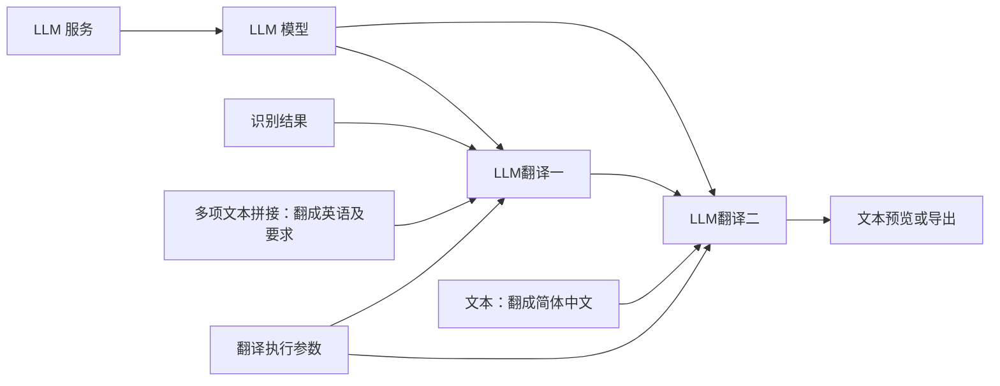

# LLM API 翻译

`llm_translate` 使用兼容 Chat Completions 的 HTTP API。处理节点消费上游当前文本、LLM 模型、可手填或接线的字符串 `context` 及可选执行参数，不引入 Agent 或工具调用。当前契约见[字段输入规格](../spec/service-families-field-inputs.md)。

## 搭建

1. 添加 LLM 服务，填写 Chat Completions 的 API base 和 Key。例如接口是 `https://example.com/v1/chat/completions`，地址填 `https://example.com/v1`。
2. 连接 LLM 模型，填写自由模型名；可选请求参数可手填 JSON，或连接 JSON 值/合并结果。
3. 在翻译节点直接写上下文；也可以从上下文编辑框左侧插口连接文本值，或连接文本拼接节点的多项文本：例如“翻译成简体中文”“保留语气”“术语：先輩=前辈”。每项可手填或接线，可排序、删除；按顺序直接连接，空格及换行写在文本自身，不提供分隔符。
4. 识别结果连接 LLM 翻译的 transcript，LLM 模型接 llm_model，外部文本可接 context；接线隐藏编辑框、断线恢复手填值；结果连接预览或导出。超时、分批和有限重试由翻译执行参数提供。

没有专用翻译上下文表单，不再分别要求源语言、目标语言或 JSON 术语表。上下文不为空白，最多 64 KiB UTF-8，原文作为字符串传给模型；应用不解析自然语言猜目标、不自动翻译或重新排布用户要求。同一字符串、模型或执行参数可分支复用。

## 当前文本与输出协议

翻译、预览和导出只读取直接上游的当前文本。模型必须返回 `{language,translations}`：有效输出语言代码及准确匹配本批 ID 的非空译文。分批语言不一致、遗漏、重复、错 ID、拒绝或截断按既有有限重试规则失败，不猜语言、不发布部分产物。

成功后把译文写入新 Transcript 的 translated_text，并用 metadata.current_text 声明该字段和模型返回语言。连续翻译消费上一份译文和语言，原文、ID、顺序、时间轴、speaker 和其他元数据保留。无当前文本声明的识别结果按原文读取，非法声明不回退。只重跑输出可复用翻译 checkpoint，不新增云请求。

## 分批与运行

未连接执行参数时，整次超时 120 秒，每批最多 20 段、正文和相邻片段共 6000 字符、前后各最多 2 段上下文、最多 2 次尝试。该预算不包含自由提示，不是 token 预算；单段超限在首个请求前拒绝，不拆分片段或补造时间戳。

请求默认只发模型和消息，显式附加参数不能覆盖核心输入、认证、路由、消息或输出结构。仅明确限流、服务端错误和无效输出作有限重试；断线或超时不重发未确认请求。单响应上限 4 MiB，累计译文上限 64 MiB UTF-8，失败或取消不发布部分成功结果。

连接 owner 保存不可变 Key，调用边界才解密；复制/导出剥离引用。排队、批次和重试使用固定图、上下文与凭据版本，不读取最新模板。取消回收本地请求及连接，不能撤回远端已处理内容。

图/运行/批次/设置为 4.0，旧命名空间不读取、不转换；项目音频继续可用。测试使用假服务，不代表真实模型质量、计费或未实测系统已验收。
