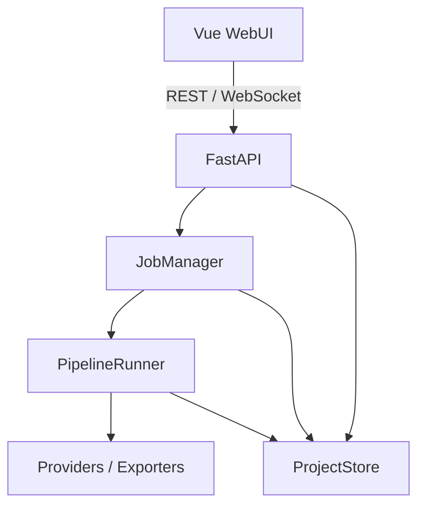

# VoiceTransl v0.1 最小实现框架

> 文档状态：Draft / 可进入开发  
> 目标版本：v0.1  
> 适用场景：单机或个人服务器上的 ASMR 音频转写与翻译 WebUI  
> 核心原则：文件系统是唯一持久化数据源，不使用数据库

> 兼容说明：本文保留 v0.1 单音频项目的历史基线。当前一个项目可以包含多个音频，资源粒度、并发保护、目录扩展与音频 API 以 [多音频项目契约](voicetransl_multi_audio_project.md) 为准；本文“一个项目一个任务”等单音频假设仅描述旧项目/主音频，不约束整个多音频父项目。既有 Pipeline、Provider、状态机和原子持久化规则继续适用。

## 1. 本文结论

v0.1 先交付一条可运行的纵向链路：

```text
浏览器上传音频
  → 创建项目目录
  → 后台运行 Pipeline
  → Mock ASR 生成日文片段
  → Mock Aligner 补齐/校验时间轴
  → Mock Translator 生成中文
  → 导出中日双语 SRT 与中文 LRC
  → 浏览器查看进度并下载结果
```

首轮不接入真实 Qwen3-ASR。先用 Mock Provider 验证数据模型、目录格式、恢复机制、API 和 WebUI；整个链路稳定后，再逐个替换 Provider。

## 2. v0.1 范围

### 2.1 必须实现

- WebUI 上传单个音频文件并填写项目名称。
- 后端创建独立项目目录，并保存源文件与 `project.json`。
- 后端异步启动任务，请求立即返回，不阻塞 HTTP 连接。
- Pipeline 包含 `preprocess → asr → alignment → translation → export` 五个阶段。
- 每个阶段结束后持久化中间结果与 `job.json`。
- 页面通过 WebSocket 接收任务进度、阶段变化和错误事件。
- 程序重启后能够重新扫描项目，并将未正常结束的任务标记为 `interrupted`。
- 支持从第一个未完成阶段继续运行。
- 导出中日双语 SRT、中文 SRT 和中文 LRC。
- 文件写入采用原子替换，避免 JSON 被部分写入。
- 提供最小自动化测试，覆盖数据序列化、状态恢复、导出和主 API 链路。

### 2.2 明确不做

- 真实 Qwen3-ASR、CrispASR 或其他模型推理。
- 真实 forced alignment。
- 真实外部 LLM 翻译。
- 左右声道拆分、Demucs、人声分离、VAD。
- 字幕波形编辑器与逐句人工编辑。
- 多用户、权限系统、登录。
- Redis、Celery、SQLite、PostgreSQL。
- 多进程 Web 后端、多机器 Worker、多 GPU 调度。
- 自动抓取 DLsite 元数据。
- 桌面打包与自动更新。

这些能力均可在 v0.1 的接口上扩展，但不应阻塞首轮交付。

## 3. 技术栈

### 后端

- Python 3.12+
- FastAPI：REST API 与 WebSocket
- Pydantic v2：领域对象、配置和接口校验
- Uvicorn：单进程开发及本地运行
- PyYAML：应用配置与 Pipeline preset
- `python-multipart`：文件上传
- pytest：自动化测试

### 前端

- Vue 3
- TypeScript
- Vite
- Pinia：仅保存前端会话状态
- 原生 `fetch` 与 `WebSocket`；v0.1 不引入额外请求库

### 外部程序

v0.1 Mock 链路不强制依赖 FFmpeg。进入真实预处理阶段后，再将 FFmpeg 作为启动时检查的外部依赖。

## 4. 系统边界



职责约束：

- WebUI 只理解项目、任务、片段、输出和事件，不理解模型实现。
- API 层只做请求校验、资源路由和响应转换，不直接运行模型。
- `JobManager` 管理内存中的运行任务和取消信号。
- `PipelineRunner` 决定阶段顺序、状态迁移、恢复和失败处理。
- Provider 只处理算法能力，不写项目状态。
- `ProjectStore` 是所有持久化操作的唯一入口。
- 文件系统是可恢复状态的唯一真相；内存状态丢失后必须能从文件重建。

## 5. 仓库目录

```text
voicetransl/
├── backend/
│   ├── pyproject.toml
│   ├── app/
│   │   ├── main.py
│   │   ├── api/
│   │   │   ├── projects.py
│   │   │   ├── jobs.py
│   │   │   ├── outputs.py
│   │   │   └── websocket.py
│   │   ├── domain/
│   │   │   ├── enums.py
│   │   │   ├── project.py
│   │   │   ├── job.py
│   │   │   └── transcript.py
│   │   ├── application/
│   │   │   ├── job_manager.py
│   │   │   ├── event_bus.py
│   │   │   └── services.py
│   │   ├── pipeline/
│   │   │   ├── context.py
│   │   │   ├── stage.py
│   │   │   ├── runner.py
│   │   │   └── stages/
│   │   │       ├── preprocess.py
│   │   │       ├── asr.py
│   │   │       ├── alignment.py
│   │   │       ├── translation.py
│   │   │       └── export.py
│   │   ├── providers/
│   │   │   ├── protocols.py
│   │   │   └── mock/
│   │   │       ├── asr.py
│   │   │       ├── aligner.py
│   │   │       └── translator.py
│   │   ├── exporters/
│   │   │   ├── srt.py
│   │   │   └── lrc.py
│   │   ├── storage/
│   │   │   ├── atomic.py
│   │   │   └── project_store.py
│   │   └── config.py
│   └── tests/
│       ├── unit/
│       └── integration/
├── frontend/
│   ├── package.json
│   ├── vite.config.ts
│   └── src/
│       ├── api/
│       ├── components/
│       ├── stores/
│       ├── types/
│       ├── views/
│       │   ├── ProjectsView.vue
│       │   ├── NewProjectView.vue
│       │   └── ProjectDetailView.vue
│       ├── App.vue
│       └── main.ts
├── config/
│   ├── app.yaml
│   └── presets/
│       └── mock.yaml
├── data/
│   └── projects/
├── scripts/
│   ├── dev.ps1
│   └── dev.sh
├── .env.example
├── .gitignore
└── README.md
```

目录不要在 v0.1 继续细分成更多“抽象层”。新增模块必须对应明确职责，而不是为了追求目录完整。

## 6. 项目文件规范

一个项目对应一个完整、可复制的目录：

```text
data/projects/<project-id>/
├── project.json
├── job.json
├── source/
│   └── original.flac
├── cache/
│   └── preprocess.json
├── transcript/
│   ├── raw.json
│   ├── aligned.json
│   └── translated.json
├── output/
│   ├── zh.srt
│   ├── ja-zh.srt
│   └── zh.lrc
└── logs/
    └── pipeline.log
```

约束：

- `project-id` 由后端生成，建议格式为 `prj_<uuid4 hex>`。
- 源文件保留用户扩展名，内部统一命名为 `original.<ext>`。
- JSON 文件必须含 `schema_version`。
- JSON 中的文件路径必须为相对项目根目录的 POSIX 风格路径。
- API 不接受用户提供的磁盘绝对路径。
- 下载路径必须先 `resolve()`，再校验结果仍位于当前项目目录内。
- `output/` 与 `cache/` 可以删除并重建；`source/` 和人工修改后的 transcript 不应被静默覆盖。

## 7. 核心数据模型

为减少 v0.1 的转换代码，领域模型和 API 内部模型统一使用 Pydantic；以后发现性能或领域隔离确有必要时，再拆分为 dataclass 与 DTO。

### 7.1 枚举

```python
from enum import StrEnum

class JobStatus(StrEnum):
    PENDING = "pending"
    RUNNING = "running"
    COMPLETED = "completed"
    FAILED = "failed"
    CANCELLING = "cancelling"
    CANCELLED = "cancelled"
    INTERRUPTED = "interrupted"

class StageStatus(StrEnum):
    PENDING = "pending"
    RUNNING = "running"
    COMPLETED = "completed"
    FAILED = "failed"
    SKIPPED = "skipped"

class PipelineStageName(StrEnum):
    PREPROCESS = "preprocess"
    ASR = "asr"
    ALIGNMENT = "alignment"
    TRANSLATION = "translation"
    EXPORT = "export"
```

### 7.2 Segment

`Segment` 是 ASR、对齐、翻译、编辑和导出的共同契约。

```python
from pydantic import BaseModel, Field, model_validator

class Segment(BaseModel):
    id: str
    start: float | None = Field(default=None, ge=0)
    end: float | None = Field(default=None, ge=0)
    source_text: str
    normalized_text: str | None = None
    translated_text: str | None = None
    language: str = "ja"
    channel: str | None = None
    speaker: str | None = None
    confidence: float | None = Field(default=None, ge=0, le=1)
    metadata: dict[str, object] = Field(default_factory=dict)

    @model_validator(mode="after")
    def validate_time_range(self):
        if self.start is not None and self.end is not None and self.end < self.start:
            raise ValueError("segment end must be >= start")
        return self
```

设计规则：

- 时间统一使用秒数 `float`，不在领域模型中保存 SRT 时间字符串。
- ASR 可以暂时返回 `start/end = null`；Alignment 负责补齐。
- Translator 只能写入 `translated_text`，不得修改 `id/start/end/source_text`。
- 导出前必须验证所有片段存在合法时间轴。
- `metadata` 只保存非核心扩展信息，稳定字段应提升为正式属性。

### 7.3 Transcript

```python
from datetime import datetime
from pydantic import BaseModel, Field

class Transcript(BaseModel):
    schema_version: str = "1.0"
    project_id: str
    stage: str
    language: str
    duration: float | None = Field(default=None, ge=0)
    created_at: datetime
    segments: list[Segment] = Field(default_factory=list)
    metadata: dict[str, object] = Field(default_factory=dict)
```

每个阶段生成新的 `Transcript` 文件，不原地修改上一阶段文件：

| 阶段 | 输入 | 输出 |
| --- | --- | --- |
| ASR | 音频 | `transcript/raw.json` |
| Alignment | `raw.json` | `transcript/aligned.json` |
| Translation | `aligned.json` | `transcript/translated.json` |
| Export | `translated.json` | `output/*` |

### 7.4 Project

```python
class SourceAsset(BaseModel):
    path: str
    original_name: str
    media_type: str | None = None
    size_bytes: int = Field(ge=0)
    language: str = "ja"

class Project(BaseModel):
    schema_version: str = "1.0"
    id: str
    name: str
    created_at: datetime
    updated_at: datetime
    source: SourceAsset
    preset: str = "mock"
    metadata: dict[str, object] = Field(default_factory=dict)
```

### 7.5 Job

```python
class StageState(BaseModel):
    status: StageStatus = StageStatus.PENDING
    progress: float = Field(default=0, ge=0, le=1)
    started_at: datetime | None = None
    finished_at: datetime | None = None
    artifact: str | None = None
    error: str | None = None

class JobError(BaseModel):
    type: str
    message: str
    stage: PipelineStageName | None = None
    retryable: bool = False

class Job(BaseModel):
    schema_version: str = "1.0"
    id: str
    project_id: str
    status: JobStatus = JobStatus.PENDING
    current_stage: PipelineStageName | None = None
    progress: float = Field(default=0, ge=0, le=1)
    created_at: datetime
    updated_at: datetime
    stages: dict[PipelineStageName, StageState]
    cancel_requested: bool = False
    error: JobError | None = None
```

总进度按五个阶段等权计算即可。真实模型接入后再通过 preset 配置阶段权重。

## 8. 持久化层

### 8.1 ProjectStore 接口

```python
from pathlib import Path
from typing import Protocol

class ProjectStore(Protocol):
    def create_project(self, project: Project) -> Path: ...
    def list_projects(self) -> list[Project]: ...
    def load_project(self, project_id: str) -> Project: ...
    def save_project(self, project: Project) -> None: ...
    def load_job(self, project_id: str) -> Job: ...
    def save_job(self, job: Job) -> None: ...
    def load_transcript(self, project_id: str, stage: str) -> Transcript: ...
    def save_transcript(self, project_id: str, name: str, value: Transcript) -> Path: ...
    def list_outputs(self, project_id: str) -> list[Path]: ...
```

`FileSystemProjectStore` 是 v0.1 唯一实现。

### 8.2 原子 JSON 写入

所有状态 JSON 使用相同函数：

```python
def atomic_write_json(path: Path, payload: dict) -> None:
    path.parent.mkdir(parents=True, exist_ok=True)
    temp_path = path.with_name(f".{path.name}.tmp")

    with temp_path.open("w", encoding="utf-8", newline="\n") as file:
        json.dump(payload, file, ensure_ascii=False, indent=2)
        file.flush()
        os.fsync(file.fileno())

    os.replace(temp_path, path)
```

补充规则：

- 临时文件必须与目标文件位于同一目录，以便 `os.replace` 保持原子性。
- 写入失败时保留旧文件，不删除有效状态。
- `pipeline.log` 可追加写入，不要求原子替换。
- v0.1 限制同一项目同时只能有一个写任务，因此暂不引入跨进程文件锁。

## 9. Pipeline 与 Provider 接口

### 9.1 PipelineContext

```python
from dataclasses import dataclass, field
from pathlib import Path

@dataclass
class PipelineContext:
    project: Project
    project_dir: Path
    job: Job
    preset: dict[str, object]
    store: ProjectStore
    cancel_event: asyncio.Event
    transcript: Transcript | None = None
    artifacts: dict[str, Path] = field(default_factory=dict)

    def check_cancelled(self) -> None:
        if self.cancel_event.is_set():
            raise PipelineCancelled()
```

### 9.2 Stage

```python
class PipelineStage(Protocol):
    name: PipelineStageName

    async def run(self, context: PipelineContext) -> None:
        ...
```

阶段只做三类事情：读取上一阶段产物、调用 Provider/Exporter、保存本阶段产物。阶段不负责决定下一阶段。

### 9.3 Provider

```python
class ASRProvider(Protocol):
    async def transcribe(self, audio: Path, project: Project) -> Transcript: ...

class AlignerProvider(Protocol):
    async def align(
        self,
        audio: Path,
        transcript: Transcript,
    ) -> Transcript: ...

class TranslationContext(BaseModel):
    source_language: str = "ja"
    target_language: str = "zh-CN"
    title: str | None = None
    character: str | None = None
    glossary: dict[str, str] = Field(default_factory=dict)
    instructions: str | None = None

class TranslatorProvider(Protocol):
    async def translate(
        self,
        segments: list[Segment],
        context: TranslationContext,
    ) -> list[Segment]: ...
```

Translator 返回后，`TranslationStage` 必须校验：

- 片段数量不变。
- ID 顺序和值不变。
- `start/end/source_text` 不变。
- 每个片段的 `translated_text` 已填写。

### 9.4 Mock Provider 行为

`MockASRProvider` 不需要读取音频内容，固定返回三个可验证片段：

```text
00:00:00.000 → 00:00:02.500  こんにちは。
00:00:02.500 → 00:00:05.000  先輩、こっちを見て。
00:00:05.000 → 00:00:08.000  そう、いい子ですね。
```

`MockAlignerProvider` 保持文本不变，对时间轴做合法性校验后返回副本。

`MockTranslatorProvider` 按 ID 返回固定中文：

```text
你好。
前辈，看这边。
对，真是个乖孩子。
```

Mock Provider 应支持可配置延迟，例如每阶段 300–800 ms，以便前端能观察状态变化。

## 10. PipelineRunner

```python
class PipelineRunner:
    def __init__(self, stages: list[PipelineStage], event_bus: EventBus):
        self.stages = stages
        self.event_bus = event_bus

    async def run(self, context: PipelineContext, resume: bool = True) -> None:
        for stage in self.stages:
            context.check_cancelled()

            state = context.job.stages[stage.name]
            if resume and state.status == StageStatus.COMPLETED:
                await self._restore_stage_artifact(stage.name, context)
                continue

            await self._mark_stage_running(stage.name, context)
            try:
                await stage.run(context)
            except PipelineCancelled:
                await self._mark_cancelled(context)
                return
            except Exception as exc:
                await self._mark_failed(stage.name, exc, context)
                raise
            else:
                await self._mark_stage_completed(stage.name, context)

        await self._mark_job_completed(context)
```

状态写入顺序：

1. 将当前阶段设为 `running`，保存 `job.json`，发布事件。
2. 执行阶段。
3. 原子保存本阶段产物。
4. 将阶段设为 `completed`，记录产物路径，再保存 `job.json`。
5. 发布阶段完成事件。

如果第 3 步成功但第 4 步前进程崩溃，恢复时默认重跑该阶段。Provider 和 Exporter 必须允许覆盖自身输出，以保持幂等。

## 11. JobManager 与运行约束

v0.1 使用 FastAPI 进程内的 `asyncio.Task`：

```python
class JobManager:
    tasks: dict[str, asyncio.Task]
    cancel_events: dict[str, asyncio.Event]
```

规则：

- Uvicorn 只能以一个 worker 运行。
- 同一项目同时最多一个任务。
- 全局同时运行任务数默认为 1，通过 `asyncio.Semaphore` 限制。
- HTTP 创建任务后立即返回 `202 Accepted`。
- 阻塞型 Provider 将来必须使用独立子进程或 `asyncio.to_thread`，不得阻塞事件循环。
- 取消为协作式取消：阶段在批次边界调用 `context.check_cancelled()`。
- 后端启动时扫描所有 `job.json`，将 `running/cancelling` 改为 `interrupted`。
- `interrupted/failed/cancelled` 任务均可用 `resume=true` 重新启动。

v0.1 不承诺进程崩溃后自动继续执行，只承诺状态可见并可人工点击继续。

## 12. 事件协议

WebSocket 地址：

```text
WS /api/projects/{project_id}/events
```

统一事件结构：

```json
{
  "schema_version": "1.0",
  "event_id": "evt_...",
  "type": "stage.progress",
  "project_id": "prj_...",
  "job_id": "job_...",
  "timestamp": "2026-09-21T14:30:00Z",
  "data": {
    "stage": "asr",
    "progress": 0.42,
    "message": "Mock ASR 处理中"
  }
}
```

v0.1 支持以下事件：

| 事件 | 说明 |
| --- | --- |
| `job.started` | 任务进入运行状态 |
| `stage.started` | 阶段开始 |
| `stage.progress` | 阶段进度更新 |
| `stage.completed` | 阶段产物已持久化 |
| `job.completed` | 全部输出已生成 |
| `job.failed` | 任务失败，携带可展示错误 |
| `job.cancelled` | 任务已取消 |

WebSocket 只用于通知，不能作为状态真相。前端连接或重连后必须先调用 REST 获取最新 `job.json` 状态。

## 13. REST API 契约

统一前缀：`/api/v1`。

### 13.0 上传限制查询

`GET /api/v1/upload-policy` 返回 `200 OK`：

```json
{
  "allowed_extensions": ["wav", "flac", "mp3", "m4a", "aac", "ogg", "opus"],
  "max_upload_bytes": 4294967296
}
```

两个字段取自当前服务使用的上传配置，与创建项目的格式和大小校验一致。
`allowed_extensions` 为配置中的扩展名列表（通常为不带点的小写值），不额外规范化；
上传文件后缀转为小写并去掉点后，必须与列表成员完全匹配。
`max_upload_bytes` 为 `max_upload_mb × 1024 × 1024`，表示每个文件的最大字节数。
此接口只读，不创建项目、不启动任务，也不返回密钥、路径或其他运行配置。
前端应通过已配置的 API 地址读取限制；创建项目时的后端校验仍是最终依据。

### 13.1 创建项目

```http
POST /api/v1/projects
Content-Type: multipart/form-data
```

字段：

- `file`：音频文件，必填。
- `name`：项目名，可选；缺省使用文件名。
- `source_language`：缺省 `ja`。
- `preset`：缺省 `mock`。

成功：`201 Created`

```json
{
  "project": {"id": "prj_...", "name": "track01", "preset": "mock"},
  "job": {"id": "job_...", "status": "pending"}
}
```

创建项目不自动运行，避免上传完成即占用计算资源。

当前接口创建包含首个音频 `aud_primary` 的项目，`project.source` 保留兼容。
多文件上传后续文件使用 `POST /api/v1/projects/{project_id}/audios` 添加到同一项目，
不再次调用创建项目接口。资源列表与逐音频 API 见多音频项目契约。

### 13.2 项目查询

```text
GET /api/v1/projects
GET /api/v1/projects/{project_id}
```

列表通过扫描 `data/projects/*/project.json` 构建，按 `updated_at` 倒序。v0.1 不做复杂搜索与分页，可限制最多返回最近 200 个项目。

### 13.3 运行与取消

```http
POST /api/v1/projects/{project_id}/run
Content-Type: application/json

{"resume": true}
```

成功：`202 Accepted`

```json
{"job_id": "job_...", "status": "pending"}
```

取消：

```text
POST /api/v1/projects/{project_id}/cancel
```

重复运行请求返回 `409 Conflict`，而不是创建第二个任务。

上述旧路径只运行/取消主音频 `aud_primary`，不会启动或取消项目内其他音频。
多音频选择使用逐音频接口或 `/projects/{project_id}/audios/run`；并发保护作用于
单个音频，而非整个父项目。

### 13.4 状态与字幕

```text
GET /api/v1/projects/{project_id}/job
GET /api/v1/projects/{project_id}/transcript
```

`transcript` 默认按 `translated → aligned → raw` 的优先级返回当前最完整版本，并在响应中给出实际阶段。

上述旧路径与下节旧输出路径均指向主音频；其他音频的状态、字幕、输出通过
`/projects/{project_id}/audios/{audio_id}/...` 访问，各音频时间轴相互独立。

### 13.5 输出列表与下载

```text
GET /api/v1/projects/{project_id}/outputs
GET /api/v1/projects/{project_id}/outputs/{filename}
```

输出列表响应：

```json
{
  "items": [
    {"name": "zh.srt", "size_bytes": 318, "download_url": "..."},
    {"name": "ja-zh.srt", "size_bytes": 487, "download_url": "..."},
    {"name": "zh.lrc", "size_bytes": 122, "download_url": "..."}
  ]
}
```

### 13.6 错误响应

```json
{
  "error": {
    "code": "PROJECT_NOT_FOUND",
    "message": "项目不存在",
    "details": null
  }
}
```

至少定义：

- `VALIDATION_ERROR` → 422
- `PROJECT_NOT_FOUND` → 404
- `JOB_ALREADY_RUNNING` → 409
- `OUTPUT_NOT_FOUND` → 404
- `UNSUPPORTED_MEDIA_TYPE` → 415
- `FILE_TOO_LARGE` → 413
- `INTERNAL_ERROR` → 500

## 14. WebUI 最小界面

v0.1 只需要三个视图。

### 项目列表

- 项目名、源文件名、更新时间。
- 当前任务状态和总进度。
- “新建项目”入口。
- 点击进入项目详情。

### 新建项目

- 拖拽或选择一个音频文件。
- 项目名输入框。
- 语言固定显示日语，preset 固定显示 Mock。
- 上传进度与错误提示。
- 创建成功后跳转项目详情，不自动运行。

### 项目详情

- 项目和源文件信息。
- “开始”或“继续”按钮。
- “取消”按钮。
- 五阶段状态与总进度。
- 当前事件/错误信息。
- 当前字幕片段只读表格。
- 输出文件下载按钮。

前端状态恢复规则：

1. 打开详情页时先请求项目和 Job。
2. 如果 Job 正在运行，再连接 WebSocket。
3. 收到事件后更新 UI，但关键状态仍以 REST 响应为准。
4. WebSocket 断线后指数退避重连；重连成功立即重新请求 Job。

## 15. Exporter 规则

### SRT

- 毫秒四舍五入并规范化进位。
- 序号从 1 开始。
- 中文版使用 `translated_text`。
- 双语版每条先写 `source_text`，下一行写 `translated_text`。
- 缺少时间轴或翻译时直接失败，不生成残缺文件。

双语示例：

```srt
1
00:00:00,000 --> 00:00:02,500
こんにちは。
你好。
```

### LRC

- v0.1 使用每个片段的开始时间。
- 时间格式为 `[mm:ss.xx]`，精度为 10 毫秒。
- 只导出中文。
- 暂不生成逐字增强 LRC。

## 16. 配置文件

`config/app.yaml`：

```yaml
app:
  host: 127.0.0.1
  port: 8000
  data_dir: ./data
  max_upload_mb: 4096
  allowed_extensions: [wav, flac, mp3, m4a, aac, ogg, opus]

jobs:
  max_concurrent: 1

logging:
  level: INFO
```

`config/presets/mock.yaml`：

```yaml
name: mock
stages:
  - preprocess
  - asr
  - alignment
  - translation
  - export

providers:
  asr: mock
  aligner: mock
  translator: mock

mock:
  delay_ms: 500
```

API Key 等密钥将来只能通过环境变量注入，不能写入 `project.json`、preset 或日志。

## 17. 安全与可靠性底线

- 上传文件名只用于展示，不直接作为磁盘路径。
- 使用后端生成的安全内部文件名。
- 限制扩展名和上传大小；真实接入 FFmpeg 后再补充内容探测。
- 禁止输出接口接受 `/`、`\\`、`..` 等路径片段。
- 所有 JSON 使用 UTF-8。
- 日志不记录 API Key、Authorization header 或完整翻译提示词中的敏感内容。
- 异常返回用户可理解的信息，详细 traceback 只进入服务端日志。
- 项目创建失败时清理尚未完成的临时项目目录；已正式创建的项目不自动删除。
- 不允许从浏览器提交任意本地文件路径或命令参数。

## 18. 测试计划

### 单元测试

- `Segment` 拒绝负时间和 `end < start`。
- Project、Job、Transcript JSON 往返不丢字段。
- 原子写入失败时旧文件仍可读取。
- Translator 校验能发现漏段、换 ID、改时间轴。
- SRT 时间格式覆盖毫秒进位、分钟和小时。
- LRC 时间格式正确。
- `ProjectStore` 拒绝路径穿越。
- Pipeline 在已完成阶段上执行恢复而非重复运行。
- Pipeline 失败时正确写入阶段和 Job 错误。
- 取消信号在阶段边界生效。

### 集成测试

1. 上传临时音频文件，确认目录和 `project.json/job.json` 创建。
2. 启动任务，轮询直到完成。
3. 验证三个 transcript/output 产物存在。
4. 验证输出 API 可以下载三个文件。
5. 模拟中途失败，再以 `resume=true` 重跑。
6. 模拟启动时存在 `running` Job，确认变为 `interrupted`。
7. 同一项目重复启动返回 409。

### 前端最小测试

- 上传表单校验。
- Job 状态到 UI 标签的映射。
- WebSocket 事件更新进度。
- 断线重连后以 REST 状态纠正界面。
- 完成后显示三个下载入口。

## 19. 开发顺序

### M0：工程初始化

- 建立前后端目录。
- 添加配置加载、日志和健康检查 `GET /api/v1/health`。
- 建立 CI 或本地统一检查命令。

### M1：领域模型与文件存储

- 完成 Project、Job、Transcript、Segment。
- 完成 `FileSystemProjectStore` 和原子写入。
- 完成项目创建与查询 API。

验收：上传一个文件后，磁盘上形成合法完整的项目目录。

### M2：Mock Pipeline

- 完成 Provider 协议、三个 Mock Provider、两个 Exporter。
- 完成五个 Stage、PipelineRunner 和恢复逻辑。
- 完成运行、取消、状态、字幕和输出 API。

验收：只调用 API 即可完成上传到字幕下载的闭环。

### M3：事件与 WebUI

- 完成 EventBus 与项目 WebSocket。
- 完成三个 WebUI 视图。
- 处理重连、错误展示和下载。

验收：浏览器能够完成全流程，刷新页面后状态不丢失。

### M4：稳固与交付

- 补齐测试和错误处理。
- 验证 Windows 路径与 UTF-8 文件名。
- 编写开发启动脚本与 README。

验收：在一台干净环境中按 README 可启动并完成演示流程。

## 20. v0.1 完成定义

以下条件全部满足，才能视为 v0.1 框架完成：

- [ ] 不依赖数据库即可启动。
- [ ] 可从 WebUI 上传一个支持格式的音频文件。
- [ ] 每个项目拥有独立、可复制的目录。
- [ ] HTTP 请求不会被 Pipeline 长任务阻塞。
- [ ] 五个阶段状态实时可见并写入 `job.json`。
- [ ] Mock Pipeline 能生成 `raw/aligned/translated` 三份 JSON。
- [ ] 能生成并下载中文 SRT、中日双语 SRT、中文 LRC。
- [ ] 刷新页面不会丢失状态。
- [ ] 异常退出后任务被识别为 `interrupted`，并可继续。
- [ ] 同一项目不会并发运行两个任务。
- [ ] 核心单元与 API 集成测试通过。
- [ ] Windows 与 Linux 上的项目路径处理均通过测试。

## 21. v0.2 接入真实能力的顺序

v0.1 通过验收后，建议按以下顺序演进：

1. 用 FFmpeg 实现真实 `PreprocessStage`，统一到可控的 WAV 格式。
2. 用 CrispASR/Qwen3-ASR 替换 `MockASRProvider`。
3. 根据 ASR capability 判断是否需要 Alignment。
4. 接入真实 forced aligner，并增加无时间轴输入测试。
5. 接入 OpenAI-compatible Translator，加入批处理、重试和结构化响应校验。
6. 增加字幕编辑 API 与 WebUI 编辑器。
7. 增加左右声道与 ASMR 专用预处理。

每次只替换一个 Provider，并继续复用 v0.1 的 API、状态机、文件格式和验收测试。真实模型接入不应改变 WebUI 的资源模型。

## 22. 冻结的架构决策

在 v0.1 开发期间，以下决策视为已冻结：

1. 前端使用 WebUI，后端使用 FastAPI。
2. 文件系统是唯一持久化数据源，不使用数据库。
3. 一个项目对应一个可独立复制的目录。
4. 时间统一以秒数存储，字幕格式转换由 Exporter 完成。
5. ASR、Alignment、Translation 相互独立。
6. LLM/Translator 不得生成或修改时间轴。
7. Pipeline 以 Stage 运行，每个阶段结束后持久化。
8. WebSocket 只传事件，REST/文件负责真实状态。
9. v0.1 单进程、单 Worker、同一项目单任务。
10. 先以 Mock Provider 跑通，再接真实模型。

如果后续需求与这些决策冲突，应先更新本文档和 `schema_version`，再修改实现，避免前后端和磁盘数据格式各自演化。

## 23. 详尽后端设计基线

本节补充 v0.1 的实现边界、状态机和运行时行为。它与前文的 API、数据模型和完成定义具有同等约束力；如果实现与本节冲突，应先更新文档，再修改代码。

### 23.1 分层职责

后端固定使用以下职责边界：

```text
REST / WebSocket API
        ↓
JobManager / EventBus
        ↓
PipelineRunner / PipelineStage
        ↓
Provider / Exporter
        ↓
ProjectStore
        ↓
项目目录
```

- `domain/` 只定义 Project、Job、Transcript、Segment、枚举和状态规则。
- `storage/` 是访问项目目录的唯一入口，负责 JSON、路径和恢复扫描。
- `application/` 管理任务生命周期、并发限制和事件分发。
- `pipeline/` 决定阶段顺序、恢复、取消、失败和阶段产物。
- `providers/` 只提供 ASR、Alignment、Translation 能力，不直接写状态文件。
- `exporters/` 只负责把已校验的 Transcript 转成字幕格式。
- `api/` 只负责请求校验、资源路由和错误转换，不直接运行模型。

API 层不能绕过 `ProjectStore` 写入项目状态。Provider 不能依赖 FastAPI、JobManager 或具体磁盘布局。

### 23.2 项目与任务生命周期

v0.1 一个项目只保留一个当前任务文件 `job.json`。任务 ID 仍然唯一，项目 ID 与任务 ID 不复用。

任务状态迁移固定为：

```text
pending → running
running → completed
running → failed
running → cancelling → cancelled
running → interrupted
failed / cancelled / interrupted → pending → running
```

规则如下：

1. 创建项目只创建 `pending` 任务，不自动占用运行资源。
2. 启动任务必须立即返回 `202 Accepted`，Pipeline 在进程内异步执行。
3. 同一项目已有运行任务时，新的启动请求返回 `409 JOB_ALREADY_RUNNING`。
4. `failed`、`cancelled`、`interrupted` 可以用 `resume=true` 从首个未完成阶段继续。
5. `completed` 默认拒绝重复运行；需要重新生成时，必须显式使用重新运行语义并创建新的 Job ID，不能静默覆盖旧任务状态。
6. 进程启动扫描所有项目，`running` 和 `cancelling` 任务统一转成 `interrupted`，不自动继续执行。

### 23.3 阶段状态与持久化顺序

每个阶段必须遵循同一顺序：

1. 将阶段状态写成 `running`，保存 `job.json`，发布 `stage.started`。
2. 执行阶段并在可取消边界检查取消信号。
3. 将阶段产物原子写入对应路径。
4. 将阶段状态写成 `completed`，记录相对 artifact 路径，再保存 `job.json`。
5. 发布 `stage.completed` 和最终的阶段进度事件。

如果进程在第 3 步后、第 4 步前退出，恢复时默认重跑该阶段。所有 Provider 和 Exporter 都必须允许安全覆盖自己的输出，保证阶段幂等。

阶段与产物的固定映射为：

| 阶段 | 产物 |
| --- | --- |
| preprocess | `cache/preprocess.json` |
| asr | `transcript/raw.json` |
| alignment | `transcript/aligned.json` |
| translation | `transcript/translated.json` |
| export | `output/zh.srt`、`output/ja-zh.srt`、`output/zh.lrc` |

总进度 v0.1 按五个阶段等权计算。之后如果 preset 支持阶段权重，必须在配置和文档中同时定义权重校验规则。

### 23.4 存储和文件安全

`ProjectStore` 必须保证以下不变量：

- 所有 JSON 使用 UTF-8、`schema_version` 和项目相对 POSIX 路径。
- JSON 先写同目录临时文件，刷新并同步后使用 `os.replace()` 替换目标文件。
- 上传先写入临时项目目录，项目元数据和源文件完整后再正式创建项目。
- `source/` 和可能被人工修改的 transcript 不得被输出阶段静默覆盖。
- `cache/` 和 `output/` 可以删除并重建。
- 任意项目 ID、transcript 名称和输出文件名都必须拒绝 `/`、`\\`、`..` 和解析后的目录越界。
- 下载接口必须在 `resolve()` 后验证路径仍位于当前项目的 `output/` 内。

### 23.5 JobManager 并发和取消

`JobManager` 使用单进程 `asyncio.Task`、全局 `asyncio.Semaphore` 和每项目 `asyncio.Lock`。

启动请求中“检查是否运行、写入 pending、登记取消事件、创建 task”必须处于同一项目锁内，避免两个并发请求同时通过检查。

取消采用协作式语义：

- API 请求只设置取消事件并将任务置为 `cancelling`。
- 阶段在批次边界调用 `check_cancelled()`。
- 阶段抛出 `PipelineCancelled` 后，Runner 持久化 `cancelled` 并发布 `job.cancelled`。
- 取消不删除已有中间产物，后续可以选择继续或重新运行。

阻塞型 Provider 不得直接占用事件循环；接入真实模型时应使用子进程或 `asyncio.to_thread`，并保持 API 层异步返回。

### 23.6 Provider 和 Stage 契约

Provider 只处理能力，不改变任务状态：

```python
ASRProvider.transcribe(audio, project) -> Transcript
AlignerProvider.align(audio, transcript) -> Transcript
TranslatorProvider.translate(segments, context) -> list[Segment]
```

`TranslationStage` 必须验证：

- 返回片段数量与输入相同；
- ID 顺序和值完全相同；
- `start`、`end`、`source_text` 完全相同；
- 每个片段都拥有非空 `translated_text`。

时间轴只能由 ASR 或 Alignment 产生。Translator 不得生成、修正或覆盖时间轴。

### 23.7 事件语义

WebSocket 是通知通道，不是状态存储，也不承担事件重放。连接建立后先发送当前 Job snapshot，之后发送：

```text
job.started
stage.started
stage.progress
stage.completed
job.completed
job.failed
job.cancelled
```

事件必须包含 `schema_version`、唯一 `event_id`、`project_id`、`job_id`、UTC 时间戳和 `data`。事件丢失不能破坏任务状态；客户端断线重连后必须重新请求 REST 状态。

### 23.8 API 和错误边界

API 只返回资源状态和用户可理解的错误，不返回 traceback。错误统一使用：

```json
{
  "error": {
    "code": "JOB_ALREADY_RUNNING",
    "message": "任务正在运行",
    "details": null
  }
}
```

至少保持以下错误码：

| 错误码 | HTTP 状态 |
| --- | --- |
| `VALIDATION_ERROR` | 422 |
| `PROJECT_NOT_FOUND` | 404 |
| `JOB_ALREADY_RUNNING` | 409 |
| `OUTPUT_NOT_FOUND` | 404 |
| `UNSUPPORTED_MEDIA_TYPE` | 415 |
| `FILE_TOO_LARGE` | 413 |
| `INTERNAL_ERROR` | 500 |

### 23.9 配置和日志

配置优先级固定为：代码默认值 → YAML 配置 → 环境变量覆盖。密钥只能从环境变量读取，不得写入 preset、项目 JSON、任务 JSON 或日志。

服务端日志记录阶段开始、完成、失败、取消和恢复信息，但不能记录 API Key、Authorization header 或包含敏感内容的完整翻译提示词。详细 traceback 只进入服务端日志，客户端只得到稳定错误码和简短消息。

### 23.10 v0.1 冻结选择

在没有新的架构变更记录前，采用以下默认选择：

1. 一个项目只保留一个当前 Job。
2. `completed` 任务默认拒绝重复运行；重新生成时显式创建新的 Job ID。
3. 上传失败通过临时项目目录清理，不删除已经正式创建的项目。
4. 五个阶段等权计算总进度。
5. WebSocket 不做历史事件重放，以 REST snapshot 修正客户端状态。
6. 单进程、单 Worker、全局并发默认 1、每项目最多一个运行任务。

这些选择可以在 v0.2 调整，但调整前必须同时更新本文档、磁盘 schema 和相关测试。
